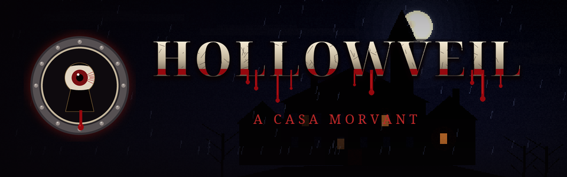
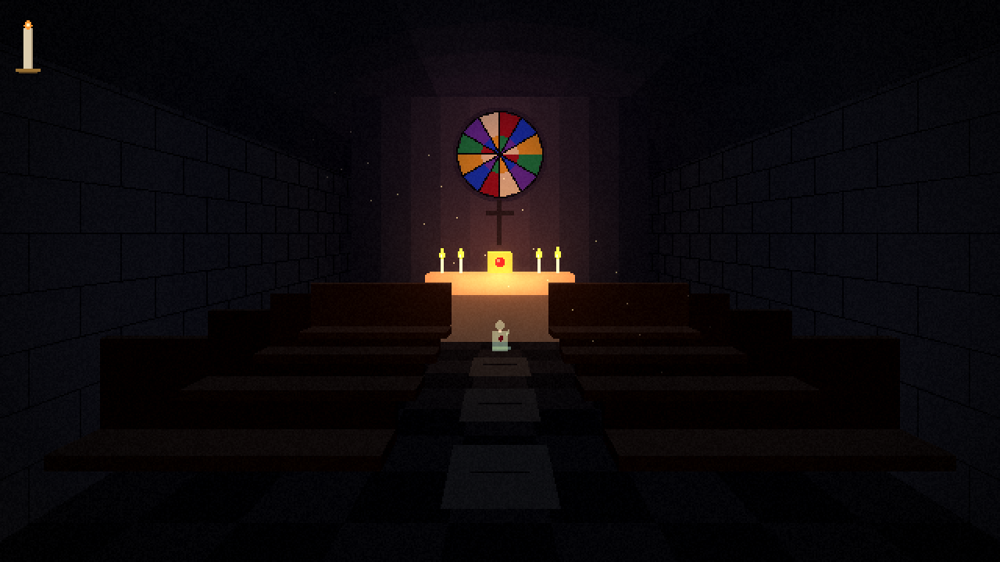
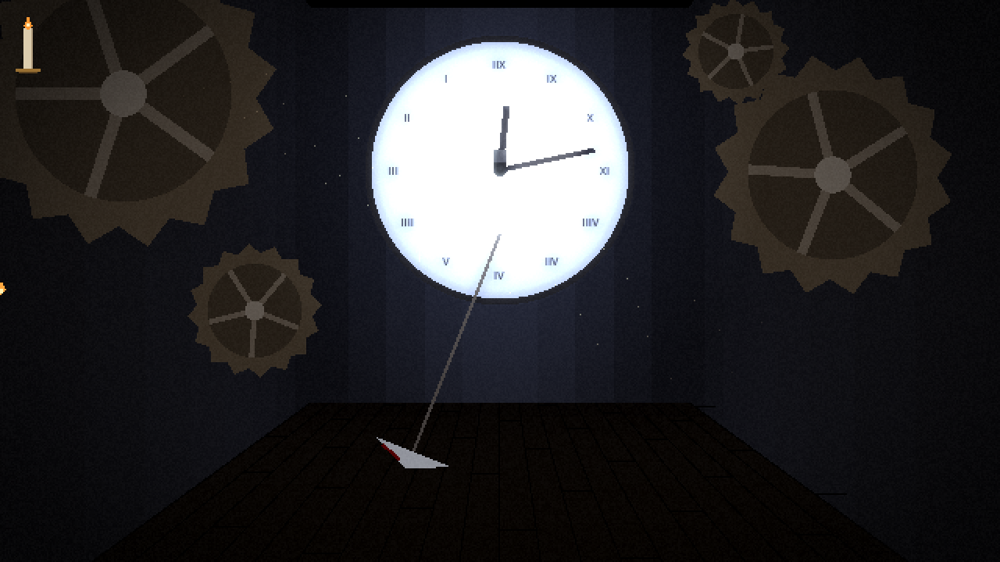
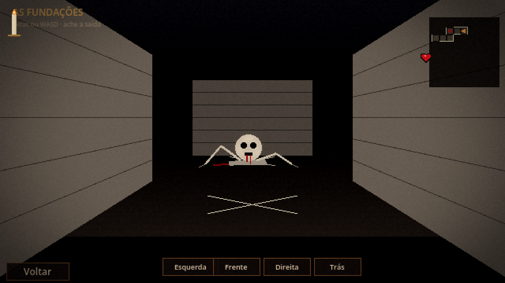
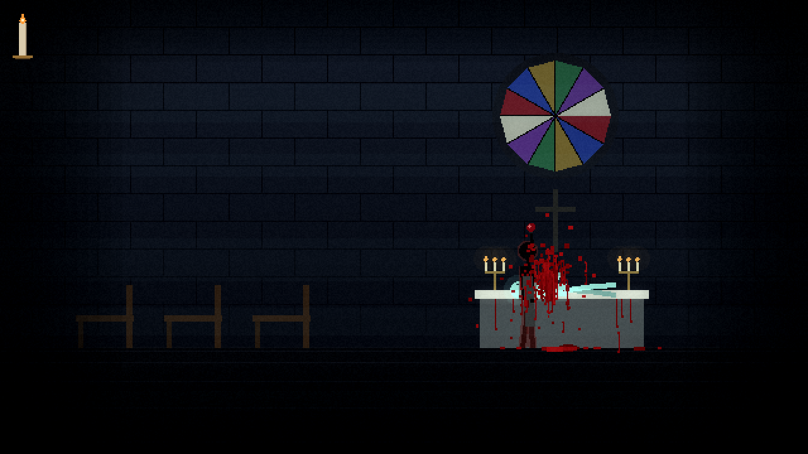
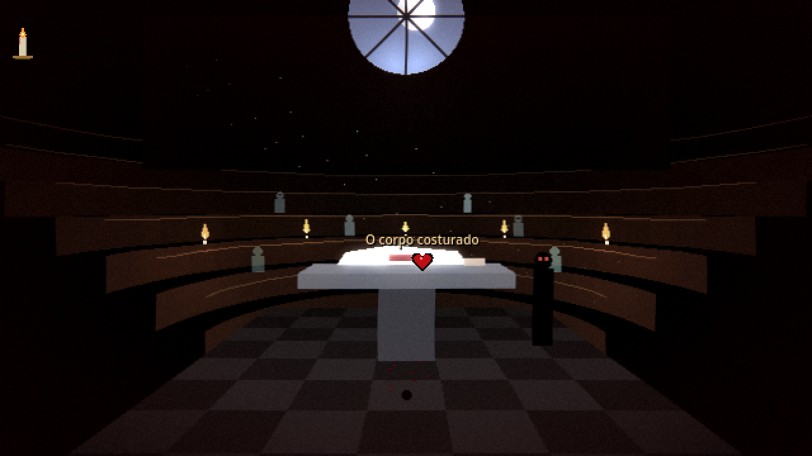
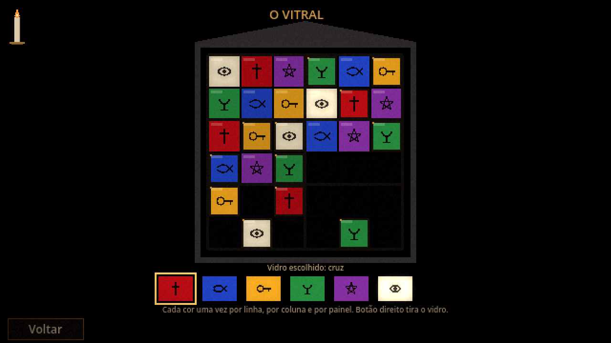

<div align="center">


# HOLLOWVEIL — A Casa Morvant

**Horror em primeira pessoa com enigmas: uma médium falsa, uma mansão fechada desde 1911 e sete mortos presos a enigmas.**

[](https://github.com/igonozoid/hollowveil/releases/latest)


[](https://igonoz.itch.io/hollowveil)



### [⬇️ Baixar para Windows](https://github.com/igonozoid/hollowveil/releases/latest) · [Linux](https://github.com/igonozoid/hollowveil/releases/latest) · [Jogar no navegador (itch.io)](https://igonoz.itch.io/hollowveil)

</div>

---

## 📖 A história

**Outono de 1924.** Treze anos atrás, o Dr. **Ezequiel Morvant** ofereceu um último jantar à família e a seis convidados. Ninguém saiu da casa. A polícia achou a sopa fria e nenhum corpo.

Agora um advogado contrata **Dália Ferraz**, uma médium falsa, para "acalmar a casa" antes do leilão. Ela atravessa a porta e o véu se fecha às suas costas. Morvant, que só aparece como voz, retrato e silhueta, a recebe encantado: *"Uma médium. Enfim, alguém que escuta."*

Cada um dos sete mortos está preso a um cômodo por um enigma. Resolvido o enigma, o morto encena a própria morte diante de Dália, e aos poucos o plano de Morvant aparece: costurar um corpo com as partes dos convidados para trazer de volta o filho que nasceu morto.

| Andar | Cômodos | Almas |
|---|---|---|
| **Térreo** | Saguão, sala de jantar, biblioteca, cozinha, estufa, sala de música | Leocádia, Tobias, Benedita, Celeste |
| **1º andar** | Corredor, quartos de Celeste, de hóspedes e de Ofélia, banheiro, berçário | Hélio, Ofélia |
| **Porões** | Galeria, adega, câmara fria, capela, cripta, labirinto das fundações | Padre Anselmo |
| **Sótão** | Sótão, torre do relógio, Teatro Anatômico | O confronto com Morvant |

## 🖼️ Telas

<table>
  <tr>
    <td><br><sub>A capela, quando o coração volta ao relicário</sub></td>
    <td><br><sub>A torre do relógio, parada em 23h47</sub></td>
  </tr>
  <tr>
    <td><br><sub>O labirinto das fundações, e o que rasteja atrás de Dália</sub></td>
    <td><br><sub>Uma das sete cenas de morte</sub></td>
  </tr>
  <tr>
    <td><br><sub>O Teatro Anatômico</sub></td>
    <td><br><sub>O Vitral, um dos 19 enigmas</sub></td>
  </tr>
</table>

## ✨ O que tem no jogo

- **Uma casa inteira em primeira pessoa**, cômodo a cômodo, com avanço de câmera entre as vistas.
- **19 enigmas gerados por semente**: plano de mesa, deslizante, resta-um, "apague as luzes", cifra, memória, engrenagens, transvaso, rotação de peças, balança, mentiroso, empurrar caixas, vitral, nonograma, labirinto, cadeado de símbolos, espelhos e pega-varetas. Cada volta é diferente, e um solucionador garante a solução de todos.
- **7 cenas de morte e 4 memórias** encenadas em vista lateral. O sangue é a única coisa com cor de verdade (o gore pode ser desligado).
- **Sanidade:** sustos, erros e pistas cobram caro; pouca sanidade distorce a casa e muda o final.
- **Pistas da Prancheta**, em três níveis. Na terceira, Morvant resolve por você, e cobra.
- **4 finais**, um deles secreto.
- **40 relíquias** escondidas (o diário de Morvant, fotografias, peças) e **A Noite Mais Escura**, uma segunda volta mais cruel.
- **Mapa da casa** com os cômodos visitados, as almas e as relíquias de cada um; clique num cômodo para ir direto até ele.
- **Efeitos:** coração que bate na vinheta quando a sanidade cai, sangue na lente nos sustos, filme antigo, fumaça das velas e cartões de andar.
- **Opções:** resolução Leve ou Nítida, dificuldade, legendas grandes e velocidade das falas, clarões dos relâmpagos, filme antigo, Modo VGA e transições rápidas.
- **Console de cheats** (tecla `=`): `deus`, `resolver`, `ir capela`, `abrir`, `reliquias`, `final medium` e outros.
- **Tudo feito por código:** nenhuma imagem ou som externo. Cômodos, personagens, luzes, música e efeitos são gerados pelo próprio jogo, em 640×360 ampliado, com Modo VGA opcional.

## 🎮 Como jogar

| Ação | Entrada |
|---|---|
| Andar, examinar, abrir enigma, adiantar fala | clique (o cursor muda conforme a ação) |
| Sair do enigma, pular cena, pausar | Esc |
| Mapa da casa (e viagem rápida) | M, ou Esc → Mapa |
| Relicário | Esc → Relicário |
| Console de cheats | = (digite `ajuda`) |
| Tela cheia | F11 |

Travou? O [walkthrough](docs/WALKTHROUGH.md) tem a rota, o método de cada enigma, os finais e as 40 relíquias (com spoilers).

**Instalação:** no Windows, extraia e abra `HollowVeil.exe` (SmartScreen: Mais informações → Executar assim mesmo). No Linux, extraia e rode `./HollowVeil.x86_64`. No navegador, jogue direto no [itch.io](https://igonoz.itch.io/hollowveil).

## 🛠️ Para desenvolvedores

O jogo fica em [`game/`](game/) (Godot 4.7, só GDScript, renderizador Compatibility). Detalhes de estrutura, testes e ferramentas estão em [`game/README.md`](game/README.md); o design completo, em [`docs/design/GDD.md`](docs/design/GDD.md).

```bash
flatpak run org.godotengine.Godot --path game
```

```bash
tests/run_tests.sh
```

```bash
tools/itch/build.sh
```

## 📜 Créditos

Design, código, arte procedural, música e textos: IGNF Lab, com Claude (Anthropic). Feito em Godot 4.
